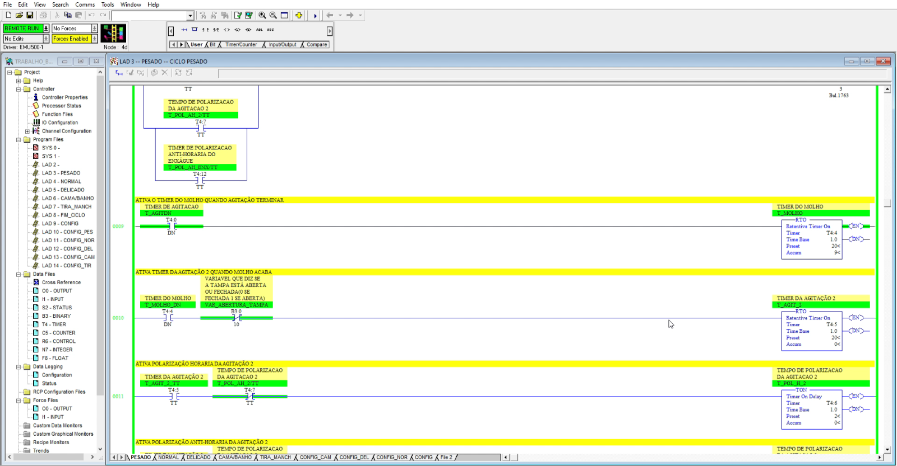

# Automação de uma máquina de lavar em ladder (CLP)

Programa em **lógica ladder** para um CLP Allen-Bradley MicroLogix que automatiza uma máquina de
lavar roupas com cinco ciclos de lavagem: pesado, normal, delicado, cama/banho e tira-manchas.
Desenvolvido e validado em simulação no RSLogix Micro, com o RSLogix Emulate 500 e o RSLinx
Classic, no trabalho em equipe da disciplina de Automação Industrial (UFMT, 2025).

## Como o programa é organizado

- **Programa principal (LAD 2):** controla o estado de funcionamento e pausa e chama o ciclo
  escolhido, depois de conferir que a configuração foi carregada. Cada ciclo só pode ser
  selecionado uma vez por lavagem.
- **Um arquivo por ciclo (LAD 3 a LAD 7):** cada ciclo é uma sub-rotina (JSR) que encadeia as
  etapas de enchimento, agitação, molho, drenagem, enxágue e centrifugação.
- **Configuração por ciclo (LAD 9 a LAD 14):** as diferenças entre os ciclos (tempos, nível de água
  e regras de enxágue, como o enxágue duplo) ficam em rotinas de configuração que carregam os
  parâmetros com MOV, em vez de duplicar a lógica.
- **Fim de ciclo (LAD 8):** aviso sonoro de 15 s seguido de 45 s de silêncio, repetido 4 vezes.
- **Segurança:** a tampa fica travada durante a centrifugação.

Os tempos de cada etapa usam temporizadores TON e RTO (retentivo, que guarda o tempo acumulado).

## Como abrir

Abra `trabalho-maquina-de-lavar/MaquinaDeLavarRoupas.RSS` no RSLogix Micro Starter Lite. Para
simular, use o RSLogix Emulate 500 com o RSLinx Classic.
